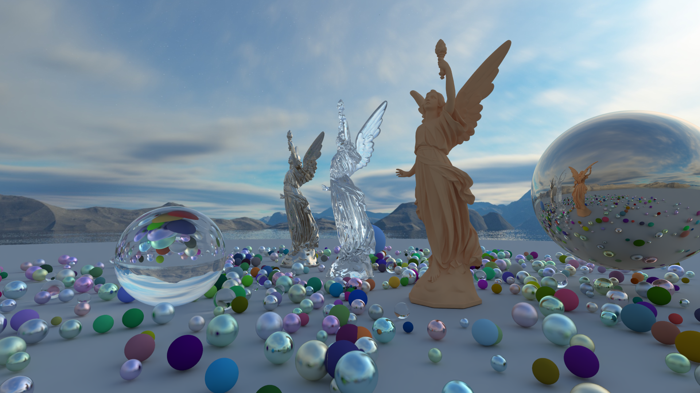
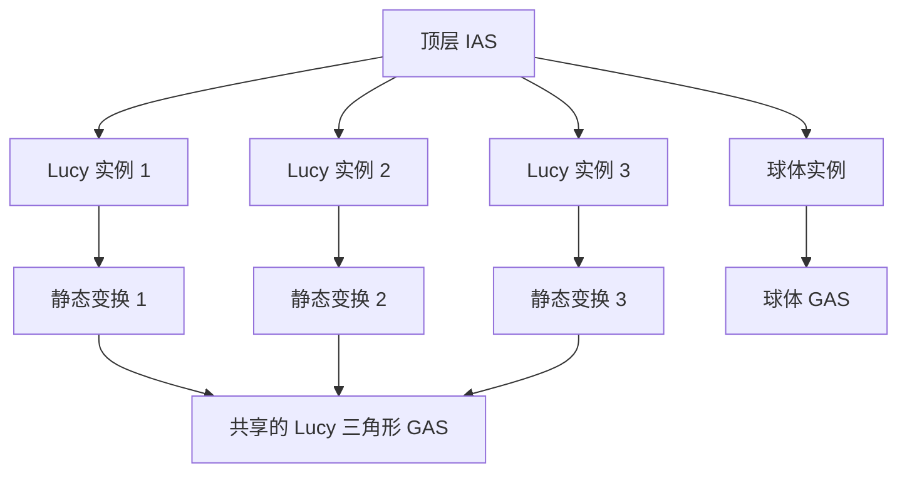

# Project 2：OptiX 光线追踪器

[English](README.md) | [简体中文](README.zh-CN.md)

`project2` 使用 OptiX 渲染由三个 Lucy 实例、一个地面球体、一组随机分布的球体和六面天空盒组成的场景，支持交互式 OpenGL 查看器和离线 PNG 渲染。环境配置见仓库的 [README](../../README.zh-CN.md)，实现要求见 [ASSIGNMENT.zh-CN.md](ASSIGNMENT.zh-CN.md)。



## 场景结构

顶层实例加速结构（IAS）包含四个实例。三个 Lucy 实例各有独立的静态变换，但都引用同一个三角形几何加速结构（GAS）。第四个实例引用球体 GAS，其中包含地面球体、随机球群和三个较大的球体。该 GAS 使用 OptiX 内置的球体图元。



天空盒由 miss 程序采样，不属于 IAS。raygen 程序使用 Lambertian 漫反射、金属和电介质材质，最多追踪 16 次反弹。球体布局使用固定随机种子。

## 依赖

`project2` 需要兼容的 NVIDIA GPU 和驱动程序、CUDA Toolkit，以及 vcpkg 清单中的以下依赖：

- OptiX 9.1 头文件：用于光线追踪
- tinyobjloader：用于加载 Lucy 模型
- GLM：用于相机数学计算
- STB：用于解码天空盒图像和写入 PNG 图像
- GLAD 和 GLFW：用于在线 OpenGL 渲染

在线模式还需要支持 OpenGL 4.5 的环境。仅离线构建不会编译或链接在线 OpenGL 查看器，因此不需要 GLAD、GLFW 或窗口系统开发环境，但仍需要 CUDA、OptiX、tinyobjloader、GLM 和 STB。

在 Ubuntu 或 Debian 上，在线 OpenGL 渲染还需要安装 GLFW 的 X11 后端所用的系统开发包：

```sh
sudo apt-get update
sudo apt-get install -y \
    pkg-config \
    libxinerama-dev \
    libxcursor-dev \
    xorg-dev \
    libglu1-mesa-dev
```

CMake/vcpkg 清单提供 C++ 库；这些系统包则提供构建 GLFW 时所需的 X11/OpenGL 开发文件。

## 构建

在仓库根目录使用 vcpkg 预设配置并构建。在 Windows 上，从 Windows Terminal 的 Developer PowerShell for VS 中执行：

```powershell
cmake --preset windows-vs-release-vcpkg
cmake --build --preset windows-vs-release-vcpkg --target project2
```

调试构建使用 `windows-vs-debug-vcpkg`。在 Linux 上，使用对应的 Linux 预设：

```sh
cmake --preset linux-gcc-release-vcpkg
cmake --build --preset linux-gcc-release-vcpkg --target project2
```

构建过程从 `src/optix_programs.cu` 生成 `assets/optix/project2.optixir`。CMake 检查 `src/optix_programs.cu` 和 `include/launch_params.h` 的时间戳，任一文件变化时都会重新构建 OptiX IR。场景资源存在时，构建会将 `assets/models/lucy.obj` 和六张天空盒图像复制到可执行程序旁的 `assets/` 目录。提交包可以在没有模型和图像时独立构建，生成的 IR 始终部署到可执行程序旁。

配置 CMake 时可通过 `PROJECT2_OPTIX_IR` 指定 IR 输出文件，例如
`-DPROJECT2_OPTIX_IR=/path/to/project2/assets/optix/project2.optixir`。
默认生成在项目构建目录的 `assets/optix/` 下。
构建 `project2_optix_ir` 目标可仅生成 IR，构建 `project2` 则构建完整程序。

## 在线模式

运行 `project2` 时不传入 `--offline` 即可打开查看器，默认窗口大小为 1280×720。例如在 Windows 上：

```powershell
.\out\build\windows-vs-release-vcpkg\projects\project2\project2.exe
```

使用 WASD 水平移动，Q/E 垂直移动，鼠标滚轮向场景靠近或远离。相机始终朝向场景中心。移动相机或调整帧缓冲区尺寸会重置样本的运行平均值。

按 Space 切换降噪，按 Escape 关闭窗口。窗口标题会显示降噪状态；切换降噪会保留原始样本平均值。查看器默认启用降噪。启用降噪时，每次重置累积后的第一帧采样四次，之后每帧采样一次。

## 离线模式

`--offline` 在不打开窗口的情况下渲染一张图像，打印渲染耗时，并写入 RGBA PNG。默认分辨率为 1920×1080，每像素采样 64 次，启用降噪。例如：

```sh
./project2 --offline \
    --width 640 --height 360 --samples 64 --denoiser on --output render.png
```

| 选项 | 含义 |
| --- | --- |
| `--offline` | 渲染一张 PNG；默认使用在线模式。 |
| `--assets <path>` | 模型、天空盒和 OptiX IR 的资源根目录，默认是可执行程序旁的 `assets/`。 |
| `--width <pixels>` | 图像或窗口宽度，必须为正数。 |
| `--height <pixels>` | 图像或窗口高度，必须为正数。 |
| `--samples <count>` | 离线采样数，必须为正数；默认值为 `64`。 |
| `--denoiser <state>` | 离线降噪状态：`on`、`off`、`1` 或 `0`；默认值为 `on`。 |
| `--output <path>` | 离线 PNG 输出路径。 |
| `--help` / `-h` | 打印命令行帮助。 |

省略 `--output` 时，文件名为 `output_<width>x<height>_<samples>s_<denoised|raw>.png`。相对输出路径以当前工作目录为基准解析。在线模式接受 `--samples` 和 `--denoiser`，但这两个选项不会改变其启动行为；使用 Space 控制查看器降噪。`--output` 必须与 `--offline` 一起使用。

可用 `--assets` 指定包含 `models/lucy.obj`、`skyboxrt/` 下六张图像和
`optix/project2.optixir` 的外部目录。配置构建时，将 `PROJECT2_OPTIX_IR` 设置为
该目录下的 `optix/project2.optixir`。
显式指定的相对路径以当前工作目录为基准解析，例如：

```sh
./project2 --offline --assets /path/to/project2/assets \
    --width 640 --height 360 --samples 64 --output render.png
```

## 不依赖 OpenGL 的构建

对于没有 OpenGL 开发库的机器或课程提交环境，可以使用 `PROJECT2_OFFLINE_ONLY=ON` 配置 `project2`。

### 从顶层构建

在仓库根目录使用 vcpkg 预设配置顶层项目时，传入该选项。

在 Linux 上：

```sh
cmake --preset linux-gcc-release-vcpkg -DPROJECT2_OFFLINE_ONLY=ON
cmake --build --preset linux-gcc-release-vcpkg --target project2
```

在 Windows 上，从 Windows Terminal 的 Developer PowerShell for VS 中执行：

```powershell
cmake --preset windows-vs-release-vcpkg -DPROJECT2_OFFLINE_ONLY=ON
cmake --build --preset windows-vs-release-vcpkg --target project2
```

### 单独构建

如需仅配置 `project2`，在仓库根目录执行以下命令。这种方式使用仓库 README 中说明的本地 `vcpkg/` 目录和仓库根目录的 `vcpkg.json`。

在 Linux 上：

```sh
cmake -S projects/project2 -B out/build/project2-offline \
    -DPROJECT2_OFFLINE_ONLY=ON \
    -DCMAKE_TOOLCHAIN_FILE="$PWD/vcpkg/scripts/buildsystems/vcpkg.cmake" \
    -DVCPKG_MANIFEST_DIR="$PWD" \
    -DVCPKG_TARGET_TRIPLET=x64-linux \
    -DCMAKE_BUILD_TYPE=Release
cmake --build out/build/project2-offline --target project2 --parallel
```

在 Windows 上，使用 `x64-windows` 和 Release 配置。从 Windows Terminal 的 Developer PowerShell for VS 中执行：

```powershell
cmake -S projects/project2 -B out/build/project2-offline `
    -DPROJECT2_OFFLINE_ONLY=ON `
    "-DCMAKE_TOOLCHAIN_FILE=$PWD/vcpkg/scripts/buildsystems/vcpkg.cmake" `
    "-DVCPKG_MANIFEST_DIR=$PWD" `
    -DVCPKG_TARGET_TRIPLET=x64-windows
cmake --build out/build/project2-offline --target project2 --config Release --parallel
```

该选项从构建目标中移除在线查看器及其 OpenGL、GLAD、GLFW 依赖。离线相机仍需要 GLM。生成的可执行程序仅支持离线渲染，因此运行时必须传入 `--offline`。

## 提交打包

完成仓库构建配置后，使用以下目标生成源码包：

```powershell
cmake --build --preset windows-vs-release-vcpkg --target submit_project2
```

在 Linux 上：

```sh
cmake --build --preset linux-gcc-release-vcpkg --target submit_project2
```

压缩包输出到 `out/build/<preset>/projects/project2/submission/project2.zip`，包含 Project 2 源码及项目使用的共享 `base/` 文件，不包含 `assets/`。
