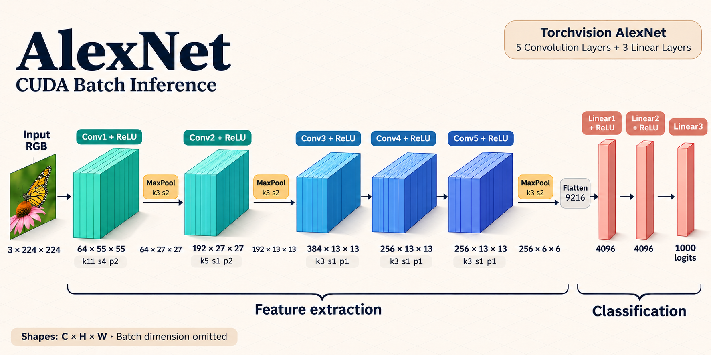
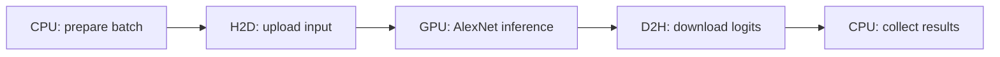

# Project 3: AlexNet inference

[English](README.md) | [简体中文](README.zh-CN.md)

`project3` performs AlexNet batch inference with CUDA. It supports benchmarking
on synthetic images and validating GPU predictions against a CPU reference on
real images. See the repository [README](../../README.md) for setup and
[ASSIGNMENT.md](ASSIGNMENT.md) for implementation and optimization requirements.
Students implement and optimize the GPU inference pipeline.



## Network structure

The model follows [torchvision AlexNet](https://github.com/pytorch/vision/blob/main/torchvision/models/alexnet.py):
five convolution layers with ReLU and max pooling, followed by three fully
connected (linear) layers. Input layout is `N × 3 × 224 × 224`, where `N` is
the batch size. Convolution output channels are `64/192/384/256/256`; the
classifier is `9216 → 4096 → 4096 → 1000`. Dropout is disabled during inference.

Each pass processes every image through the complete network and returns all
1000 class scores per image to the CPU:



## Dependencies

`project3` requires a compatible NVIDIA GPU and driver, the CUDA Toolkit, and
the following tools:

- A C++20 compiler and CMake 3.25 or newer for building the project
- Nsight Systems for application timeline analysis
- Nsight Compute for CUDA kernel analysis
- Git LFS for retrieving the model weights

A standalone build needs no vcpkg or graphics libraries. Implement computation
with standard C++ and CUDA; do not use PyTorch, cuDNN, cuBLAS, BLAS, CUTLASS or
OpenMP. The project includes the converted weights and validation images, so
Python is not needed to build or run it.

The optional [weight converter](scripts/prepare_weights.py) uses Python 3.11+
and its standard library. The [dataset preparation tool](scripts/prepare_evaluation.py)
additionally needs Pillow. Use their `--help` options when regenerating assets.

## Build

From the repository root, retrieve the model weights first:

```sh
git lfs install --local
git lfs pull
```

Configure and build with a vcpkg preset after following the repository setup.
On Windows, run these commands from Developer PowerShell for VS in Windows
Terminal:

```powershell
cmake --preset windows-vs-release-vcpkg
cmake --build --preset windows-vs-release-vcpkg --target project3
```

Use `windows-vs-debug-vcpkg` for a Debug build. On Linux:

```sh
cmake --preset linux-gcc-release-vcpkg
cmake --build --preset linux-gcc-release-vcpkg --target project3
```

Use a Release build for performance experiments. The build copies `assets/`
beside the executable, including `models/alexnet.bin` and `dataset/` with the
image lists, labels, class names and images. The full list has 100 images from
ten classes; the quick list has 10 images. Labels retain the original ImageNet
class indices, and predictions consider all 1000 classes.

The program defaults to the adjacent `assets/` directory regardless of the
working directory. Use `--assets DIR` to select another directory; an explicit
relative path is resolved from the current working directory.

## Benchmark mode

Run without arguments or with `--benchmark` to measure the GPU inference
pipeline on synthetic images. The defaults are 1024 images, batch size 64,
two streams, one warmup pass and three measured passes:

```sh
./project3 --benchmark
```

To select the configuration explicitly:

```sh
./project3 --benchmark --synthetic 1024 --batch-size 64 --streams 2 --warmup 1 --repeat 5
```

The program prints average end-to-end milliseconds and images per second.
Timing includes CPU batch preparation, H2D, the full network, D2H and all waits
until the CPU outputs are complete. Synthetic image generation, model
loading/upload, buffer allocation and warmup are outside timing. The supplied
`base` `Timer` measures all formal passes together; their total is divided by
`repeat`. Measure final performance without a profiler.

| Option | Meaning |
| --- | --- |
| `--benchmark` | Benchmark with synthetic images; default mode. |
| `--assets DIR` | Assets root; default: `assets/` beside the executable. |
| `--batch-size N` | Positive batch capacity; default: `64`. |
| `--streams N` | Positive CUDA stream count; default: `2`. |
| `--synthetic N` | Benchmark image count; default: `1024`. |
| `--seed N` | Synthetic-image seed; default: `42`. |
| `--warmup N` | Untimed complete benchmark passes; default: `1`. |
| `--repeat N` | Timed complete benchmark passes; default: `3`. |
| `--device N` | CUDA device index; default: `0`. |
| `--help` / `-h` | Print command-line help. |

Profiling commands and the required stream/kernel experiments are described in
[ASSIGNMENT.md](ASSIGNMENT.md).

## Validation mode

`--validate` runs CPU and GPU inference on the real dataset and compares their
predictions. Use the quick list while developing:

```sh
./project3 --validate --quick-validation --batch-size 8
```

Run the full list and optionally export per-image predictions:

```sh
cmake -E make_directory out
./project3 --validate --batch-size 8 --predictions out/predictions.csv
```

| Option | Meaning |
| --- | --- |
| `--validate` | Compare CPU/GPU predictions on real images, one pass each. |
| `--assets DIR` | Assets root; default: `assets/` beside the executable. |
| `--batch-size N` | Positive batch capacity; default: `64`. |
| `--streams N` | Positive CUDA stream count; default: `2`. |
| `--quick-validation` | Use the 10-image quick list; requires `--validate`. |
| `--predictions FILE` | Export per-image CPU/GPU predictions to CSV; requires `--validate`. |
| `--device N` | CUDA device index; default: `0`. |
| `--help` / `-h` | Print command-line help. |

Validation reports Top-1 agreement and Top-5 set agreement. Both must match
on every image; a mismatch returns a failure exit code. Top-5 set comparison
ignores the order of the five classes. Ground-truth Top-1/Top-5 accuracy is
reported separately: the CPU and GPU can agree on an incorrect prediction.

The CSV includes each image's CPU/GPU predictions, class names and correctness
against its label. CPU inference can be slow; use quick validation for
iteration and full validation at each optimization milestone. This small
subset does not measure accuracy on the full ImageNet validation set.

## Standalone build

To configure only `project3`, run the commands below from the repository root.
This build does not require the repository's vcpkg dependencies.

On Windows, use Developer PowerShell for Visual Studio:

```powershell
cmake -S projects/project3 -B out/build/project3-windows
cmake --build out/build/project3-windows --config Release --parallel
```

The executable is `out/build/project3-windows/Release/project3.exe`.

On Linux:

```sh
cmake -S projects/project3 -B out/build/project3-linux
cmake --build out/build/project3-linux --parallel
```

The executable is `out/build/project3-linux/project3`. The standalone build
defaults to Release. When `assets/` exists in the source directory, the build
copies it beside the executable.

## Submission

Write a short report at `projects/project3/report/REPORT.md` covering the
implementation, validation, profiling observations and performance comparisons.
See [ASSIGNMENT.md](ASSIGNMENT.md) for report requirements.

Build the source package from a configured repository build:

```powershell
cmake --build --preset windows-vs-release-vcpkg --target submit_project3
```

On Linux:

```sh
cmake --build --preset linux-gcc-release-vcpkg --target submit_project3
```

The archive is written to
`out/build/<preset>/projects/project3/submission/project3.zip`. It includes
Project 3 source, the shared `base/` headers used by the project, and the
`report/` directory. It excludes `assets/`, `images/` and `scripts/`. Raw Nsight
capture files are not required for submission.
