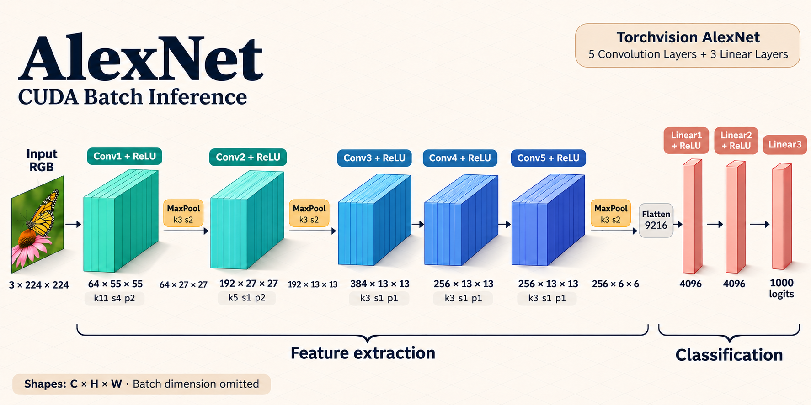
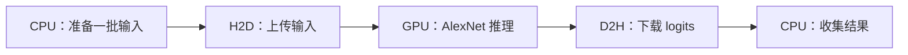

# Project 3：AlexNet 推理

[English](README.md) | [简体中文](README.zh-CN.md)

`project3` 使用 CUDA 执行 AlexNet 批量推理，支持使用合成图像进行性能测试，
以及在真实图像上对比 GPU 与 CPU 参考的预测。环境配置见仓库
[README](../../README.zh-CN.md)，实现与优化要求见
[ASSIGNMENT.zh-CN.md](ASSIGNMENT.zh-CN.md)。学生需要实现并优化 GPU 推理流程。



## 网络结构

网络采用 [Torchvision AlexNet](https://github.com/pytorch/vision/blob/main/torchvision/models/alexnet.py)
的结构：五个卷积层，配合 ReLU 和最大池化，再接三个全连接（linear）层。
输入按 `N × 3 × 224 × 224` 排列，`N` 为 batch size。
卷积输出通道依次为 `64/192/384/256/256`，分类器为
`9216 → 4096 → 4096 → 1000`。推理时关闭 dropout。

每轮让全部图像经过完整网络，并将每张图像的 1000 个类别得分传回 CPU：



## 依赖

`project3` 需要兼容的 NVIDIA GPU 和驱动程序、CUDA Toolkit，以及以下工具：

- 支持 C++20 的编译器和 CMake 3.25 或更新版本：用于构建项目
- Nsight Systems：用于程序时间线分析
- Nsight Compute：用于 CUDA 内核分析
- Git LFS：用于获取模型权重

单独构建不依赖 vcpkg 或图形库。计算使用标准 C++ 和 CUDA 实现，不调用 PyTorch、
cuDNN、cuBLAS、BLAS、CUTLASS 或 OpenMP。项目已包含转换后的权重与验证图像，
构建和运行不需要 Python。

可选的[权重转换脚本](scripts/prepare_weights.py)使用 Python 3.11+ 标准库，
[数据集准备脚本](scripts/prepare_evaluation.py)还需要 Pillow。
重新生成资源时，可使用脚本的 `--help` 查看参数。

## 构建

在仓库根目录先获取模型权重：

```sh
git lfs install --local
git lfs pull
```

按仓库说明完成环境配置后，使用 vcpkg 预设配置并构建。在 Windows 上，
从 Windows Terminal 的 Developer PowerShell for VS 中执行：

```powershell
cmake --preset windows-vs-release-vcpkg
cmake --build --preset windows-vs-release-vcpkg --target project3
```

调试构建使用 `windows-vs-debug-vcpkg`。Linux：

```sh
cmake --preset linux-gcc-release-vcpkg
cmake --build --preset linux-gcc-release-vcpkg --target project3
```

性能实验使用 Release 构建。构建会将 `assets/` 拷贝到可执行文件旁，包括
`models/alexnet.bin` 和 `dataset/` 下的图像清单、标签、类别名称及图像。
完整清单包含十个类别的 100 张图像，快速清单包含其中 10 张。
标签保留原始 ImageNet 类别索引，预测范围仍包含全部 1000 个类别。

程序默认读取可执行文件旁的 `assets/`，不依赖当前工作目录。
可用 `--assets DIR` 指定另一目录；显式指定的相对路径以当前工作目录为基准。

## Benchmark 模式

不传参数或传入 `--benchmark`，即可使用合成图像测量 GPU 推理流程。
默认使用 1024 张图像、batch size 64、两个 stream、一次预热和三次正式测量：

```sh
./project3 --benchmark
```

也可以显式指定配置：

```sh
./project3 --benchmark --synthetic 1024 --batch-size 64 --streams 2 --warmup 1 --repeat 5
```

程序输出平均端到端耗时和每秒处理的图像数。计时包含 CPU 批次准备、H2D、
完整网络计算、D2H，以及等待 CPU 输出全部就绪的时间。
合成图像生成、模型加载与上传、缓冲区分配和预热不计时。
框架使用 `base` 中的 `Timer` 测量全部正式轮次，再将总耗时除以 `repeat`。
最终性能在关闭 profiler 的普通运行中测量。

| 选项 | 含义 |
| --- | --- |
| `--benchmark` | 使用合成图像进行性能测试，默认模式。 |
| `--assets DIR` | 资源根目录，默认是可执行文件旁的 `assets/`。 |
| `--batch-size N` | 正整数批容量，默认 `64`。 |
| `--streams N` | 正整数 CUDA stream 数量，默认 `2`。 |
| `--synthetic N` | Benchmark 图像数量，默认 `1024`。 |
| `--seed N` | 合成图像随机种子，默认 `42`。 |
| `--warmup N` | 不计时的完整预热轮数，默认 `1`。 |
| `--repeat N` | 正式计时的完整轮数，默认 `3`。 |
| `--device N` | CUDA 设备索引，默认 `0`。 |
| `--help` / `-h` | 输出命令行帮助。 |

Profiler 命令及 stream、内核优化实验要求见
[ASSIGNMENT.zh-CN.md](ASSIGNMENT.zh-CN.md)。

## Validation 模式

`--validate` 在真实数据集上分别执行 CPU 和 GPU 推理，并比较预测。
开发阶段可先使用快速清单：

```sh
./project3 --validate --quick-validation --batch-size 8
```

运行完整清单，并按需导出逐图预测：

```sh
cmake -E make_directory out
./project3 --validate --batch-size 8 --predictions out/predictions.csv
```

| 选项 | 含义 |
| --- | --- |
| `--validate` | 在真实图像上分别运行一轮 CPU/GPU 推理并比较预测。 |
| `--assets DIR` | 资源根目录，默认是可执行文件旁的 `assets/`。 |
| `--batch-size N` | 正整数批容量，默认 `64`。 |
| `--streams N` | 正整数 CUDA stream 数量，默认 `2`。 |
| `--quick-validation` | 使用 10 张图像的快速清单，要求 `--validate`。 |
| `--predictions FILE` | 导出逐图 CPU/GPU 预测 CSV，要求 `--validate`。 |
| `--device N` | CUDA 设备索引，默认 `0`。 |
| `--help` / `-h` | 输出命令行帮助。 |

Validation 输出 Top-1 预测一致率和 Top-5 集合一致率，两项都需要在每张图像上
保持一致；不一致时返回失败退出码。Top-5 集合比较忽略五个类别的内部顺序。
程序另行报告相对真实标签的 Top-1/Top-5 准确率：CPU 和 GPU 可能同时分类错误。

CSV 包含每张图像的 CPU/GPU 预测、类别名称及相对标签的分类正确性。
CPU 推理可能较慢，日常迭代使用快速验证，各优化阶段完成时运行完整验证。
这里的小型子集不能用于衡量完整 ImageNet 验证集上的准确率。

## 单独构建

如需仅配置 `project3`，在仓库根目录执行以下命令，不需要仓库的 vcpkg 依赖。

Windows 使用 Visual Studio 的 Developer PowerShell：

```powershell
cmake -S projects/project3 -B out/build/project3-windows
cmake --build out/build/project3-windows --config Release --parallel
```

程序位于 `out/build/project3-windows/Release/project3.exe`。

Linux：

```sh
cmake -S projects/project3 -B out/build/project3-linux
cmake --build out/build/project3-linux --parallel
```

程序位于 `out/build/project3-linux/project3`。单独构建默认使用 Release。
如果源码目录中存在 `assets/`，构建时会将其拷贝到可执行文件旁。

## 提交打包

在 `projects/project3/report/REPORT.md` 中撰写简短报告，说明实现、正确性验证、
profiling 分析和性能对比。报告要求见 [ASSIGNMENT.zh-CN.md](ASSIGNMENT.zh-CN.md)。

完成仓库构建配置后，使用以下目标生成源码包：

```powershell
cmake --build --preset windows-vs-release-vcpkg --target submit_project3
```

在 Linux 上：

```sh
cmake --build --preset linux-gcc-release-vcpkg --target submit_project3
```

压缩包输出到 `out/build/<preset>/projects/project3/submission/project3.zip`，
包含 Project 3 源码、项目使用的共享 `base/` 头文件和 `report/` 目录，
不包含 `assets/`、`images/` 和 `scripts/`。无需提交 Nsight 原始采集文件。
